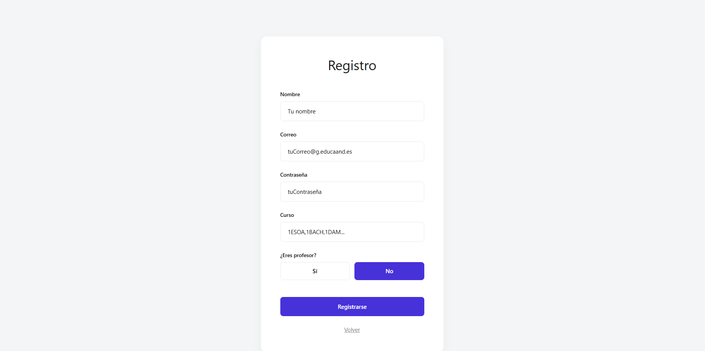
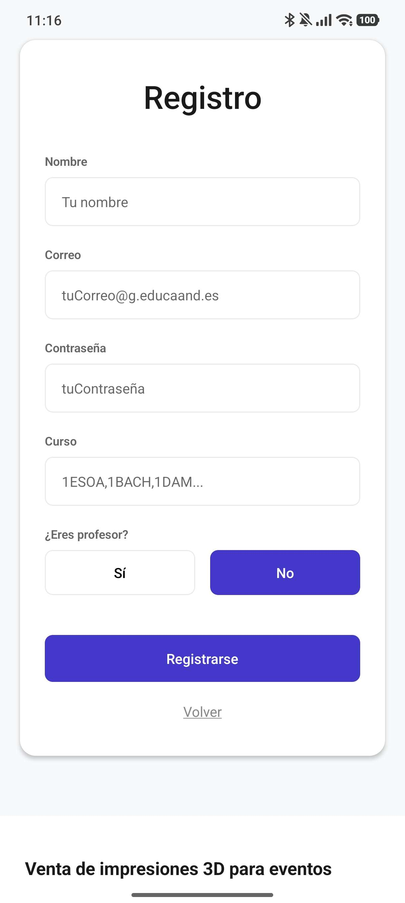

## 📝 Descripción
Este Pull Request incluye la creación y los ajustes enfocados exclusivamente en la pantalla y funcionalidad de **Registro**:

**1. Frontend (Registro):**
* **Separación de estilos Web/Móvil:** Creación y ajuste del sistema de estilos (`StyleSheet`) para la pantalla de **Registro**. Se han creado archivos `.ts` dedicados para móvil (adaptando márgenes y tamaños de los inputs/botones) y `.web.ts` para escritorio (limitando anchos máximos y mejorando la distribución del formulario).

**2. Backend y Base de Datos:**
* **Supabase (Auth):** Se ha implementado la funcionalidad de registro conectando el formulario con Supabase para permitir la creación y alta de nuevos usuarios en el sistema.

## 🔗 Issue relacionado
Closes #

## 🚀 Tipo de cambio
- [x] ✨ Nueva funcionalidad (feature)
- [ ] 🐛 Corrección de error (bugfix)
- [ ] ♻️ Refactorización (mejora de código sin añadir nueva funcionalidad)
- [ ] 🎨 Mejoras de UI/UX o estilos (Tailwind / NativeWind / StyleSheet)
- [ ] 🔧 Configuración del proyecto / Dependencias

## 📱 Cambios en la Interfaz (Si aplica)
| Antes | Después |
| --- |  |
| --- |  |

## ✅ Checklist de calidad antes de fusionar
- [x] He revisado mi propio código línea por línea antes de abrir esta PR.
- [x] He probado estos cambios en el emulador (Android/iOS) o en mi móvil físico con Expo Go y todo funciona correctamente.
- [x] El código compila sin errores ni advertencias (warnings) graves.
- [x] He eliminado los `console.log()` innecesarios o de depuración.
- [x] Mi código sigue la arquitectura y el estilo definido en el proyecto.
- [ ] He añadido o actualizado los comentarios en funciones complejas.

## 💡 Notas adicionales para el revisor / Tutor
* Para la separación de estilos web y móvil en la pantalla de Registro, se ha utilizado la convención de Expo/React Native usando extensiones `.web.ts` y `.ts`, permitiendo al empaquetador resolver la versión correcta automáticamente.