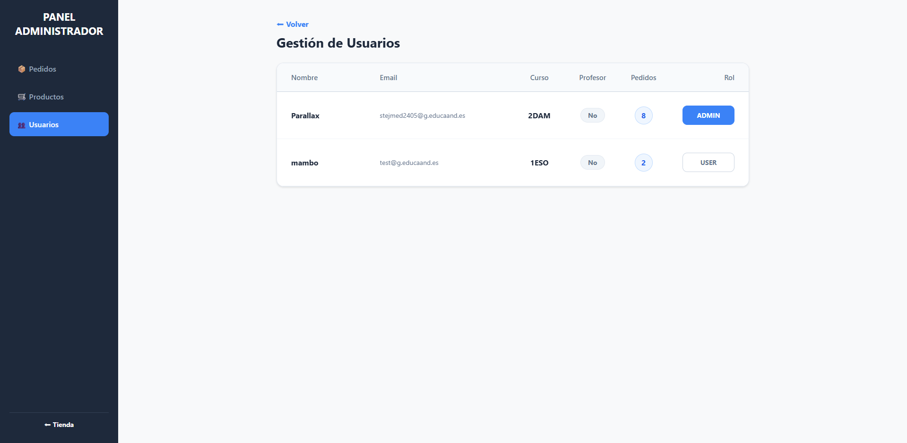
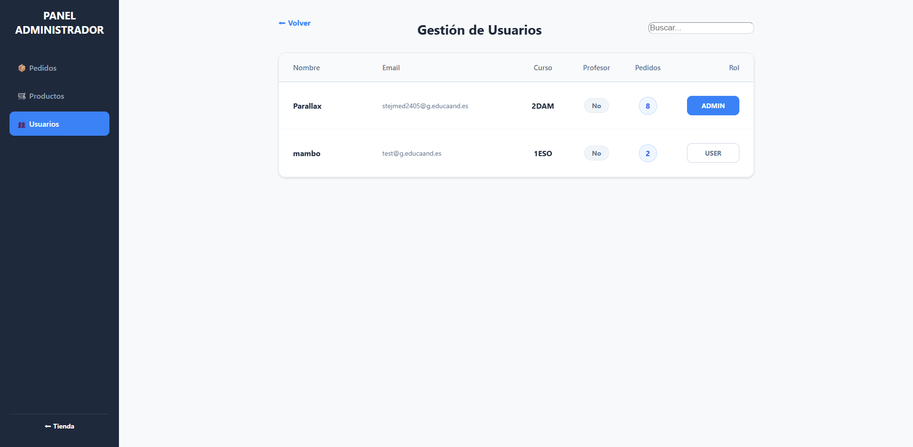

## 📝 Descripción
Este Pull Request incluye la creación y los ajustes enfocados exclusivamente en las pantallas y funcionalidades de **Pedidos del Usuario**:

**1. Frontend (admin/usuarios):**
* **Pantalla de Mis Pedidos:** Implementación de campo de texto para filtrar los usuarios por su nombre.

**2. Backend y Base de Datos:**

## 🔗 Issue relacionado
Closes #

## 🚀 Tipo de cambio
- [x] ✨ Nueva funcionalidad (feature)
- [ ] 🐛 Corrección de error (bugfix)
- [ ] ♻️ Refactorización (mejora de código sin añadir nueva funcionalidad)
- [ ] 🎨 Mejoras de UI/UX o estilos (Tailwind / NativeWind / StyleSheet)
- [ ] 🔧 Configuración del proyecto / Dependencias

## 📱 Cambios en la Interfaz (Si aplica)
| Antes | Después |
|  |  |
| --- | |

## ✅ Checklist de calidad antes de fusionar
- [x] He revisado mi propio código línea por línea antes de abrir esta PR.
- [x] He probado estos cambios en el emulador (Android/iOS) o en mi móvil físico con Expo Go y todo funciona correctamente.
- [x] El código compila sin errores ni advertencias (warnings) graves.
- [x] He eliminado los `console.log()` innecesarios o de depuración.
- [x] Mi código sigue la arquitectura y el estilo definido en el proyecto.

## 💡 Notas adicionales para el revisor / Tutor
