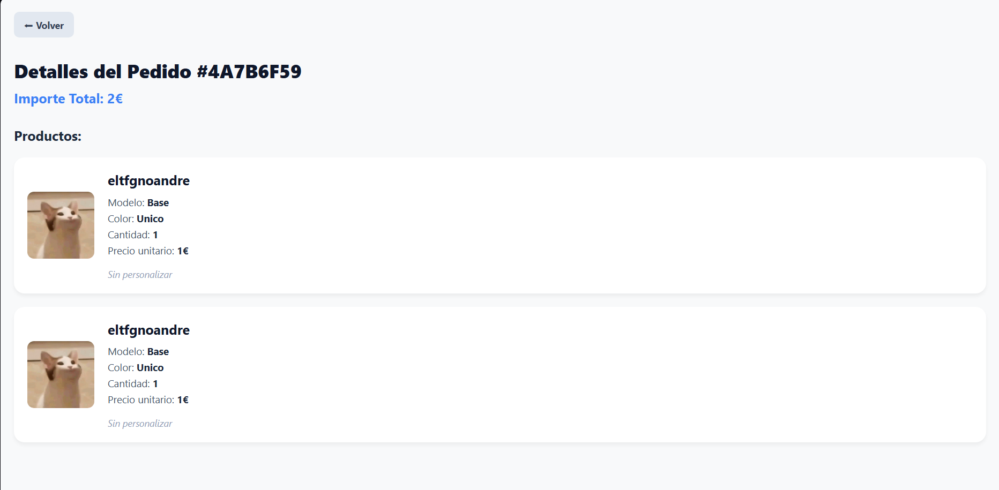

## 📝 Descripción
Este Pull Request se centra en el ajuste de estilos de diversos componentes:

**1. Frontend:**
* **Paginas detalles productos admin/usuario**Ambas paginas son iguales, ahora muestra la foto del modelo y tienen un diseño similar al del resto de la aplicacion

**2. Backend y Base de Datos:**
* **Modificacion del endpoint detalles pedido** agregado a la consulta para que traiga los datos del modelo 

## 🔗 Issue relacionado
Closes #

## 🚀 Tipo de cambio
- [ ] ✨ Nueva funcionalidad (feature)
- [ ] 🐛 Corrección de error (bugfix)
- [X] ♻️ Refactorización (mejora de código sin añadir nueva funcionalidad)
- [X] 🎨 Mejoras de UI/UX o estilos (Tailwind / NativeWind / StyleSheet)
- [ ] 🔧 Configuración del proyecto / Dependencias

## 📱 Cambios en la Interfaz (Si aplica)
| Antes | Después |
| --- |  |
| --- | |
| --- | |
| --- | |
| --- | |
| --- | |
| --- | |
| --- | |

## ✅ Checklist de calidad antes de fusionar
- [x] He revisado mi propio código línea por línea antes de abrir esta PR.
- [x] He probado estos cambios en el emulador (Android/iOS) o en mi móvil físico con Expo Go y todo funciona correctamente.
- [x] El código compila sin errores ni advertencias (warnings) graves.
- [x] He eliminado los `console.log()` innecesarios o de depuración.
- [x] Mi código sigue la arquitectura y el estilo definido en el proyecto.

## 💡 Notas adicionales para el revisor / Tutor
