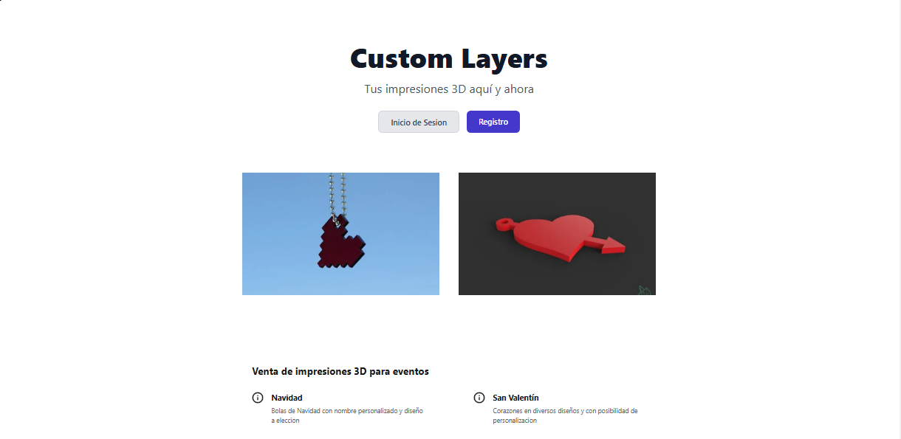

## 📝 Descripción
Este Pull Request incluye ajustes y refactorización enfocados en la API y en la Landing Page/Inicio:

**1. Frontend (Landing & Inicio):**
* **Separación de estilos Web/Móvil:** Refactorización del sistema de estilos (`StyleSheet`) para la Landing, el Grid de productos y las Cards. Se han creado archivos `.ts` dedicados para móvil (ajustando anchos al 45% y márgenes) y `.web.ts` para escritorio (limitando el ancho máximo a 1200px).
* **Limpieza de código:** Extracción de los estilos en línea (inline styles) de `inicio.tsx` a su propio archivo de estilos para mejorar rendimiento y legibilidad.

**2. Backend (API):**
* Ajustes y configuración en `main.py` para la gestión de datos y endpoints de la aplicación. *(Nota: detalla aquí brevemente si el main.py hace algo más específico como conectar a la BD o configurar CORS)*.

## 🔗 Issue relacionado
Closes #

## 🚀 Tipo de cambio
- [x] ✨ Nueva funcionalidad (feature)
- [ ] 🐛 Corrección de error (bugfix)
- [x] ♻️ Refactorización (mejora de código sin añadir nueva funcionalidad)
- [x] 🎨 Mejoras de UI/UX o estilos (Tailwind / NativeWind / StyleSheet)
- [ ] 🔧 Configuración del proyecto / Dependencias

## 📱 Cambios en la Interfaz (Si aplica)
| Antes | Después |
| --- |  |
| --- | 
| *(Añadir captura antigua o N/A)* | *(Añadir captura de la versión móvil/web adaptada)* |

## ✅ Checklist de calidad antes de fusionar
- [x] He revisado mi propio código línea por línea antes de abrir esta PR.
- [x] He probado estos cambios en el emulador (Android/iOS) o en mi móvil físico con Expo Go y todo funciona correctamente.
- [x] El código compila sin errores ni advertencias (warnings) graves.
- [x] He eliminado los `console.log()` innecesarios o de depuración.
- [x] Mi código sigue la arquitectura y el estilo definido en el proyecto.
- [ ] He añadido o actualizado los comentarios en funciones complejas.

## 💡 Notas adicionales para el revisor / Tutor
* Para la separación de estilos web y móvil, se ha utilizado la convención de Expo/React Native usando extensiones `.web.ts` y `.ts`, lo que permite al empaquetador resolver la versión correcta automáticamente según la plataforma de ejecución.